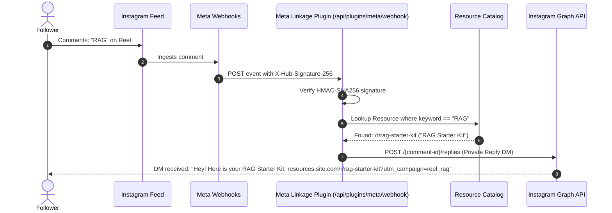

# 🔗 Meta & Instagram Account Linkage Integration Guide

This guide details how to link your Meta Developer App, Instagram Business or Creator account, and Webhook subscriptions to **DevResource**.

---

## 1. Prerequisites
1. A **Meta Developer Account** at [developers.facebook.com](https://developers.facebook.com).
2. An **Instagram Professional Account** (Business or Creator mode).
3. A **Facebook Page** linked to your Instagram Professional Account.
4. A publicly accessible HTTPS domain or tunnel (e.g. ngrok or Vercel URL) for Webhooks.

---

## 2. Setting Up Your Meta App

1. Go to [developers.facebook.com/apps](https://developers.facebook.com/apps) and click **Create App**.
2. Select **Business** or **Other** as the app use case.
3. Name your app (e.g., `DevResource Automation Engine`).
4. Add the following products to your App:
   - **Instagram Graph API**
   - **Webhooks**
   - **Facebook Login for Business**

### Required Permissions:
In App Review / Permissions & Features, enable:
- `instagram_basic`: Read profile info and media.
- `instagram_manage_comments`: Monitor comments on your Reels/Carousels and reply.
- `instagram_manage_messages`: Send private automated DMs with resource links.
- `pages_show_list`: Discover Facebook pages linked to your Instagram account.
- `pages_read_engagement`: Monitor page interactions.

---

## 3. Webhook Configuration

### 3.1 Webhook URL & Verify Token
In your Meta App Dashboard under **Webhooks** -> **Instagram**:
1. Set **Callback URL**: `https://your-domain.com/api/plugins/meta/webhook`
2. Set **Verify Token**: Enter the exact secret string you put in `.env` as `META_WEBHOOK_VERIFY_TOKEN`.
3. Click **Verify and Save**. DevResource will respond with the challenge string (`hub.challenge`).

### 3.2 Subscribing to Fields
Subscribe to the following fields:
- `comments`: Triggers when someone comments on your Reel or Carousel.
- `mentions`: Triggers when someone tags your account in a Story or post.
- `messages`: Optional if using direct Graph API messenger instead of Manychat.

---

## 4. The Comment-to-DM Trigger Flow

When a follower comments on your Reel (e.g., "RAG"):

---

## 5. Automated Token Renewal & Diagnostics

Meta tokens have different lifespans:
1. **Short-Lived User Token**: Valid for 1 to 2 hours.
2. **Long-Lived User Token**: Valid for 60 days.
3. **Never-Expiring Page Token**: Generated from a long-lived user token for pages you manage.

The Meta Plugin provides a diagnostics card at `/plugins` that:
- Inspects your current token validity.
- Displays days until expiration.
- Shows green checkmarks for verified permissions.
- Provides a one-click **"Refresh Token"** button to exchange for a new 60-day token.
