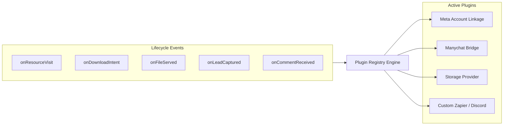

# 🧩 Plugins Architecture & Developer SDK

DevResource features an extensible **Plugin Architecture** that allows developers and creators to connect external platforms (Meta, Manychat, Discord, Slack, Zapier, Cloudflare R2, Stripe, Notion) into the resource delivery pipeline.

---

## 1. Plugin Lifecycle & Architecture

Each plugin is an isolated TypeScript/JavaScript module that declares a manifest, configuration schema, and one or more lifecycle hooks:



---

## 2. Standard Plugin Manifest

Every plugin contains a manifest adhering to `PluginDefinition`:

```typescript
export interface PluginDefinition {
  id: string;                    // unique slug: "meta-linkage"
  name: string;                  // display name: "Meta & Instagram Linkage"
  version: string;               // semver: "1.0.0"
  author: string;                // author or company
  description: string;           // short purpose
  category: "social" | "storage" | "automation" | "analytics" | "notification";
  icon: string;                  // SVG or icon token
  enabled: boolean;              // active toggle
  configured: boolean;           // credentials provided
  configFields: ConfigField[];   // schema for settings modal in UI
  settings: Record<string, any>; // persisted settings
  hooks: PluginHooks;            // lifecycle hook implementations
}
```

---

## 3. Supported Lifecycle Hooks

| Hook | Arguments | When Called |
| :--- | :--- | :--- |
| `onResourceVisit` | `{ slug, resource, utm, referrer, userAgent }` | When an audience member opens `/r/[slug]` |
| `onDownloadIntent` | `{ slug, resource, utm, ip, timestamp }` | When user clicks "DOWNLOAD RESOURCE" button |
| `onFileServed` | `{ slug, resource, storageUrl, provider, durationMs }` | When redirect or binary stream completes |
| `onLeadCaptured` | `{ email, sourceSlug, utm, timestamp }` | When a user submits the newsletter signup |
| `onCommentReceived`| `{ commentId, text, userId, postId, matchedResource }` | When Meta webhook detects an Instagram comment |

---

## 4. Writing a Custom Plugin

Here is an example of an **Outbound Discord Notifier Plugin** built using the DevResource SDK:

```typescript
import { definePlugin } from "@/lib/plugins/sdk";

export default definePlugin({
  id: "discord-notifier",
  name: "Discord Creator Notifier",
  version: "1.0.0",
  author: "Community",
  category: "notification",
  description: "Sends real-time pings to your Discord team server whenever a resource is downloaded.",
  configFields: [
    {
      key: "webhookUrl",
      label: "Discord Webhook URL",
      type: "password",
      required: true,
      placeholder: "https://discord.com/api/webhooks/...",
    },
  ],
  hooks: {
    async onDownloadIntent({ resource, utm }, context) {
      const webhookUrl = context.settings.webhookUrl;
      if (!webhookUrl) return;

      await fetch(webhookUrl, {
        method: "POST",
        headers: { "Content-Type": "application/json" },
        body: JSON.stringify({
          content: `📥 **New Download Intent!**\nResource: **${resource.title}**\nCampaign: \`${utm.campaign || "direct"}\``,
        }),
      });
    },
  },
});
```

---

## 5. Installing Plugins via the UI

1. Open `/plugins` in your browser.
2. In the **Installed Plugins** tab, click **Configure** on any plugin to supply API keys or credentials.
3. In the **Plugin Directory** tab, click **"Install Custom Plugin"** and provide either:
   - A remote JSON manifest URL
   - A raw TypeScript/JSON plugin manifest
4. The plugin will be validated against the schema and registered immediately.
