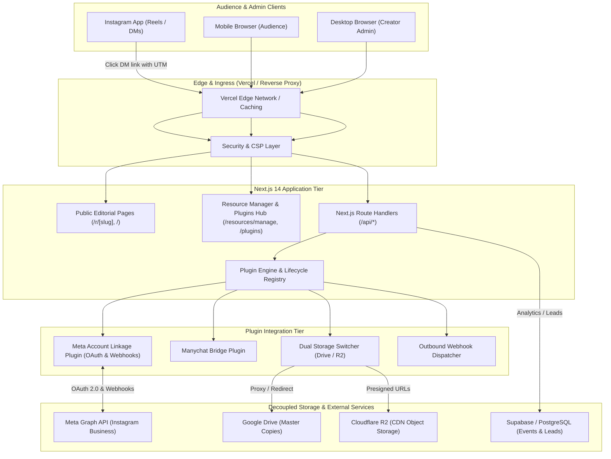
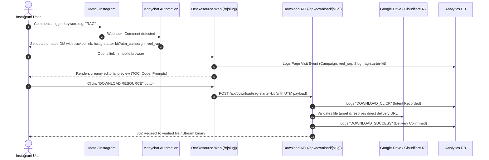
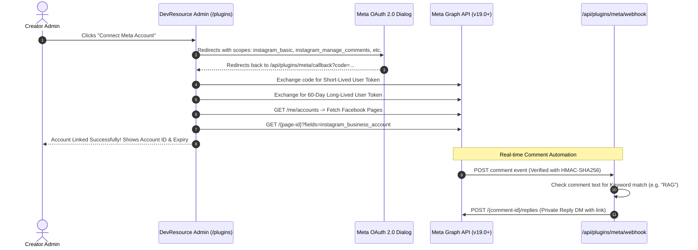

# 🏗️ System Architecture & Data Flow

## 1. High-Level Architecture Overview

DevResource separates audience traffic, resource metadata, storage delivery, and plugin extensions into independent decoupled tiers:

---

## 2. Request Lifecycles

### 2.1 The Lead-to-Download Lifecycle

---

## 3. Meta Account Linkage Architecture

---

## 4. Storage Decoupling Specification

One of the foundational design rules of DevResource is that **Google Drive is never exposed as an unmanaged hardcoded link across marketing channels**.

| Layer | Implementation | Benefit |
| :--- | :--- | :--- |
| **Public Slug Layer** | `/r/rag-starter-kit` | Permanent public link; safe to post on Instagram Reels, print on QR codes, or automate in DMs. |
| **Catalog Metadata** | `lib/catalog.ts` | Central source of truth for file names, sizes, categories, and keyword triggers. |
| **Storage Resolver** | `plugins/storage-r2-gdrive` | Switches dynamically between Google Drive direct download and Cloudflare R2 presigned URLs. |
| **Delivery Engine** | `/api/download/[slug]` | Logs analytics *before* redirecting, validates storage reachability, and protects direct file URLs from scrapers. |

---

## 5. Security & Threat Model Mitigations

1. **Meta Webhook Signature Verification**:
   - Every inbound POST to `/api/plugins/meta/webhook` validates header `X-Hub-Signature-256`.
   - Uses `crypto.createHmac('sha256', META_APP_SECRET)` against raw request buffer.
   - Rejects mismatched signatures with HTTP 401 Unauthorized.
2. **Preventing Open Redirects**:
   - The `/api/download/[slug]` endpoint strictly matches the slug against the registered resource catalog whitelist.
   - External arbitrary redirect targets are prohibited.
3. **Cross-Site Scripting (XSS) Prevention**:
   - Strict Content Security Policy configured in `vercel.json` and `next.config.mjs`.
   - All sample code and prompts sanitized and rendered safely via React.
4. **Rate Limiting**:
   - Download endpoints and newsletter submission endpoints are rate-limited per IP to prevent storage egress abuse.
